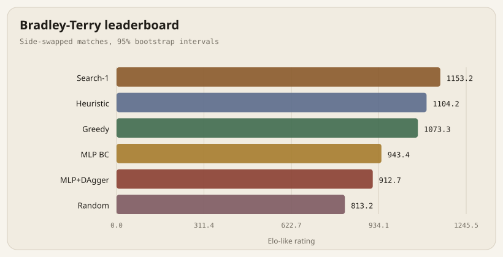
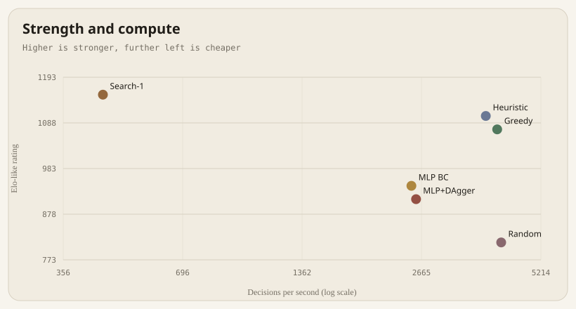
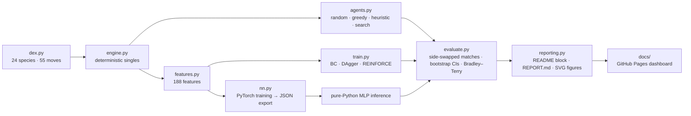

<div align="center">

# PokéLab

**A deterministic, dependency-free Pokémon battle benchmark for decision-making research.**

*Every number rerunnable. Every seed fixed. Every failure logged.*

[](https://github.com/Arudchayan/Arudchayan/actions/workflows/ci.yml)
[](https://github.com/Arudchayan/Arudchayan/actions/workflows/codeql.yml)
[](https://arudchayan.github.io/Arudchayan/)
[](pyproject.toml)
[](pyproject.toml)
[](tests)
[](LICENSE)
[](https://codespaces.new/Arudchayan/Arudchayan)

[**Dashboard**](https://arudchayan.github.io/Arudchayan/) · [**Report**](results/REPORT.md) · [**Paper**](paper/main.md) · [**Failure log**](FAILURES.md) · [**Quickstart**](#quickstart)

</div>

---

> **The short version.** I built a 24-species, 3v3 Pokémon singles engine and an
> evaluation harness designed like a research benchmark: deterministic RNG,
> side-swapped matches, shared team schedules, bootstrap confidence intervals,
> Bradley–Terry rankings, held-out species, and a logged failure file.
>
> A one-ply search agent beats a hand-tuned heuristic **69.5%** of the
> time at **497 decisions/s**. A two-ply search wins
> **90.0%** at **31 decisions/s** — a measurable
> compute–strength frontier. A neural policy distilled from search reaches
> **37.5%**; the negative result is documented rather than hidden.

> **State-of-the-art here means reproducibility and evaluation discipline, not a
> claim to superhuman play.** The benchmark is intentionally small, fast, and
> auditable; the numbers are useful because they are measured, not because they
> are large.

## Why this exists

Most toy RL environments optimize for *easy learning*. This one optimizes for
*credible evaluation*:

- **Deterministic by construction.** A 64-bit SplitMix64 stream drives every
  critical hit, damage roll, accuracy check, and speed tie. The same seed
  produces the same battle log, byte for byte.
- **Zero runtime dependencies.** The engine, agents, charts, dashboard, and
  report generator are pure Python standard library. PyTorch is optional and
  used only to train the neural policy; inference is exported to plain JSON.
- **Evaluation-first.** Side-swapped matches remove first-player bias. Every
  agent sees the same team schedule. CIs are bootstrapped, not hand-waved.
- **Held-out species.** Policies train on 18 species and are tested on six they
  never see: Volcarona, Hydreigon, Toxapex, Clefable, Zeraora, Corviknight.
- **Failure logging.** The [failure log](FAILURES.md) records bugs found during
  development and the mechanics deliberately left out. Benchmarks that hide
  their limits are marketing.

### Research questions

1. **How much does search depth buy?** Depth-1 vs depth-2 expectimax, same
   opponent model.
2. **Can search be compressed?** Distil search action values into a small MLP
   and measure the strength–compute frontier.
3. **Does behaviour cloning transfer to unseen Pokémon?** Train on 18 species,
   evaluate on six held-out species.
4. **How stable are rankings?** Bootstrap CIs, seed variance, side swaps, and
   Bradley–Terry ratings over the full round robin.

## The numbers

| Result | Value | Evidence |
| --- | ---: | --- |
| Search-1 vs Heuristic | **69.5%** | [`results/leaderboard.json`](results/leaderboard.json) |
| Search-2 vs Heuristic (oracle) | **90.0%** | [`results/oracle.json`](results/oracle.json) |
| MLP BC vs Heuristic | **37.5%** | [`results/training.json`](results/training.json) |
| MLP + DAgger vs Heuristic | **40.0%** | [`results/training.json`](results/training.json) |
| Held-out transfer gap | **-2.7 pp** | [`results/generalization.json`](results/generalization.json) |
| Engine throughput | **7,302 decisions/s** | `python -m pokerl bench` |
| Test suite | **54 tests** | `python -m pytest` |

The mean transfer gap hides the interesting asymmetry: **MLP BC drops 23.1
percentage points** on held-out species (37.4% → 14.3%), while **Search-1
improves** (64.6% → 78.0%) and **Hybrid-1 is flat** (66.0% → 66.0%). Type-aware
search transfers; a small policy distilled from it does not.

The live table below is regenerated from the committed JSON by
`python -m pokerl report`.

<!-- RESULTS:START -->
### Live benchmark snapshot

| Agent | Elo | W-L-D | Win rate | 95% CI | Decisions/s |
| --- | ---: | ---: | ---: | ---: | ---: |
| **Search-1** | 1153 | 429-158-13 | 73.1% | [69.3, 76.7] | 445 |
| **Heuristic** | 1104 | 392-204-4 | 65.8% | [61.9, 69.6] | 3827 |
| **Greedy** | 1073 | 363-230-7 | 61.2% | [57.3, 65.1] | 4078 |
| **MLP BC** | 943 | 242-348-10 | 41.0% | [37.1, 44.9] | 2519 |
| **MLP+DAgger** | 913 | 214-375-11 | 36.3% | [32.6, 40.2] | 2585 |
| **Random** | 813 | 134-459-7 | 22.6% | [19.4, 26.1] | 4171 |

- Highest-rated agent: **Search-1** at **1153** Elo.
- MLP BC reaches **41.0%** win rate in round-robin play.
- Linear BC is a negative control: **3.8%** to **0.0%**; the MLP is the model that learns.
- Mean held-out transfer gap: **-2.7 pp**.
- Search-2 oracle: **90.0%** vs Heuristic at **31 decisions/s**.



[Full report](results/REPORT.md) · [Dashboard](https://arudchayan.github.io/Arudchayan/)
<!-- RESULTS:END -->



## Quickstart

Requires **Python 3.11+**. No runtime dependencies.

```bash
git clone https://github.com/Arudchayan/Arudchayan.git
cd Arudchayan

# 1. Watch a deterministic battle
python -m pokerl demo --seed 7

# 2. Verify the engine is deterministic
python -m pokerl verify

# 3. Run the full test suite
python -m pytest

# 4. Reproduce the benchmark
python -m pokerl bench --games 120 --seed 2025

# 5. Regenerate the report and dashboard data
python -m pokerl report
```

Optional MLP training (requires PyTorch):

```bash
python -m pip install -e ".[nn]"
python -m pokerl train --decisions 5000 --mlp-epochs 80 --dagger 2
```

## Reviewer's guide

If you have five minutes and want to check the claims rather than read them:

```bash
python -m pokerl verify          # deterministic replay + basic invariants
python -m pytest -q              # 54 tests
python -m pokerl bench --games 40 --agents heuristic search-1 mlp hybrid --no-report
python -m pokerl generalize --games 40
```

Every command writes machine-readable JSON. The figures are generated from
those files, not typed by hand.

## Benchmark design

### Environment

| Property | Choice |
| --- | --- |
| Format | 3v3 singles, level 100, fixed competitive sets |
| Roster | 24 fully evolved species |
| Actions | 4 moves + up to 2 switches |
| Observation | Full state: HP, status, boosts, items, abilities, moves, PP, hazards, bench |
| Stochasticity | Damage rolls (0.85–1.00), critical hits (1/24), accuracy, speed ties, secondary effects |
| Mechanics | Types, STAB, stat stages, burn/poison/toxic/paralysis/sleep, Leftovers, Life Orb, Choice items, Focus Sash, Heavy-Duty Boots, Toxic Orb, Stealth Rock, Defog, Rapid Spin, U-turn/Volt Switch, 18 abilities |
| Omitted | Weather, terrain, Mega/Z/Dynamax, multi-hit, flinch, confusion, accuracy/evasion stages, team preview, 6v6 |
| Episode cap | 100 turns; ties broken by remaining HP fraction |

The full list of omissions is in [FAILURES.md](FAILURES.md). They are scope
decisions, not hidden assumptions.

### Agents

| Agent | Idea | Cost |
| --- | --- | --- |
| **Random** | Uniform legal action | ~6k decisions/s |
| **Greedy** | Highest expected damage | ~6k decisions/s |
| **Heuristic** | Damage + KO + setup + status + switch matchup | ~5k decisions/s |
| **Search-1** | One-ply expectimax, heuristic opponent model | ~500 decisions/s |
| **Search-2** | Two-ply expectimax (oracle reference) | ~30 decisions/s |
| **Linear BC** | Linear softmax distilled from search | ~2k decisions/s |
| **MLP BC** | 188→64→32→1 shared-trunk policy, NumPy-accelerated inference | ~3.5k decisions/s |
| **MLP+DAgger** | One round of dataset aggregation on policy states | ~100 decisions/s |
| **Hybrid-1** | MLP prior, search over top-3 actions | ~100 decisions/s |

> The six-agent round robin uses Random, Greedy, Heuristic, Search-1, MLP BC, and
> MLP+DAgger. Hybrid-1 is kept as an available agent and evaluated in the
> generalisation track; including every search hybrid in the round robin doubles
> the slowest match cost for little information.

### Evaluation protocol

- **Side-swapped pairs.** Each team pair is played twice, once with each agent
  on player 1. This removes first-player and team-composition bias.
- **Shared schedule.** Every agent pair sees the same seeded team pairs.
- **Bootstrap CIs.** 95% percentile intervals over decisive games (2,000
  resamples). Draws are reported separately.
- **Bradley–Terry.** Pairwise results are fit with the MM algorithm and mapped
  to an Elo-like scale (mean 1000, 400 points per decade of odds).
- **Held-out species.** The six held-out species never appear during
  behaviour-cloning data collection.


## Architecture



## Reproducibility

- **Deterministic RNG.** `pokerl/rng.py` implements SplitMix64; battle mechanics
  never import Python's `random`.
- **Side-swapped schedules.** `evaluate.match()` reconstructs the same team
  pairs for every agent pair from the seed.
- **Config hashes.** Every result file records the git SHA, Python version,
  platform, seed, and a SHA-256 config hash.
- **One-command report.** `python -m pokerl report` rewrites `results/REPORT.md`,
  `docs/assets/*.svg`, and the README results block from committed JSON.
- **One-command reference run.** [`experiments/run_all.py`](experiments/run_all.py)
  executes the full training → benchmark → generalisation → report pipeline and
  writes `results/run.log`.
- **Zero-dependency core.** `dependencies = []` in `pyproject.toml`. CI installs
  only dev tools.
- **Optional neural training.** `torch` is a `[nn]` extra. The exported MLP is
  plain nested lists and runs in the standard library; NumPy, when installed, is
  an optional inference accelerator.
- **Static, linted dashboard.** The Pages report is generated HTML from the
  committed JSON, with no client-side JavaScript or CDN. Hallmark `sloplint`
  reports **0 FAIL, 0 REFLEX, 0 WARN** on the dashboard.

## What I would do next

- Add weather/terrain and 6v6 team preview as separate tracks, not one giant
  engine.
- Train a value network on search returns and use it as a leaf evaluator.
- Add a **human baseline** through a small web arena; report human-vs-agent
  Elo alongside agent-vs-agent.
- Evaluate an LLM policy through a JSONL arena with tool-free, legal-action
  prompting.
- Scale the roster and run a proper metagame coverage analysis.

See [ROADMAP.md](ROADMAP.md) for the longer list.

## Research portfolio

PokéLab is part of a broader research-engineering portfolio:

- **[TraceScope](https://github.com/Arudchayan/TraceScope)** — small-LM safety
  monitor evals; seed variance, prompt brittleness, and transfer limits.
- **[AgentGate](https://github.com/Arudchayan/AgentGate)** — enforcement gate
  for agent file/email actions, with measured block rates and documented holes.
- **[NSCLC360](https://github.com/Arudchayan/NSCLC360)** — XAI-based prognosis
  research for non-small-cell lung cancer.
- **[Auto-Scientist](https://github.com/Arudchayan/Auto-Scientist)** —
  autonomous scientific discovery agent with a streaming research workflow.
- **[ResearchQuest](https://github.com/Arudchayan/ResearchQuest)** — a research
  workspace for papers, notes, ideas, and focus sessions.
- **[Turnwave](https://github.com/Arudchayan/Turnwave)** — local
  speech-to-speech assistant with interruption handling.

## Hiring

I am interested in **research engineering, ML systems, evaluation, and
reinforcement learning** roles where reproducible experiments and honest
failure analysis matter. If this repository is useful to you, open an issue or
start a discussion — I am happy to walk through the design.

## Citation

```bibtex
@software{pokerl2026,
  author  = {Arudchayan},
  title   = {PokéLab: A Deterministic, Dependency-Free Pokémon Battle Benchmark},
  year    = {2026},
  version = {1.0.0},
  url     = {https://github.com/Arudchayan/Arudchayan},
  license = {MIT}
}
```

A `CITATION.cff` is included for Zenodo/GitHub citation tooling.

<!-- DISPATCH:START -->
## 🎮 Daily Lab Dispatch — 2026-11-08

**Specimen of the day:** **Breloom** · 🌿GRASS 🥊FIGHTING · BST **460**

```text
 HP: ██████░░░░░░░░░░░░  60
ATK: █████████████░░░░░ 130
DEF: ████████░░░░░░░░░░  80
SPA: ██████░░░░░░░░░░░░  60
SPD: ██████░░░░░░░░░░░░  60
SPE: ███████░░░░░░░░░░░  70
```

**Today's experiment:** Read the held-out split before touching the train set.
**Featured matchup:** Breloom vs Scizor · seed `6972566247772334273`

> Run `python -m pokerl demo --seed 34273` to inspect a reproducible battle from today's seed.
<!-- DISPATCH:END -->

---

<sub>Pokémon is a trademark of Nintendo / Creatures / GAME FREAK. This is a
non-commercial fan research project, not affiliated with or endorsed by them.
The engine is a simplified research testbed, not a cartridge-accurate simulator.</sub>
